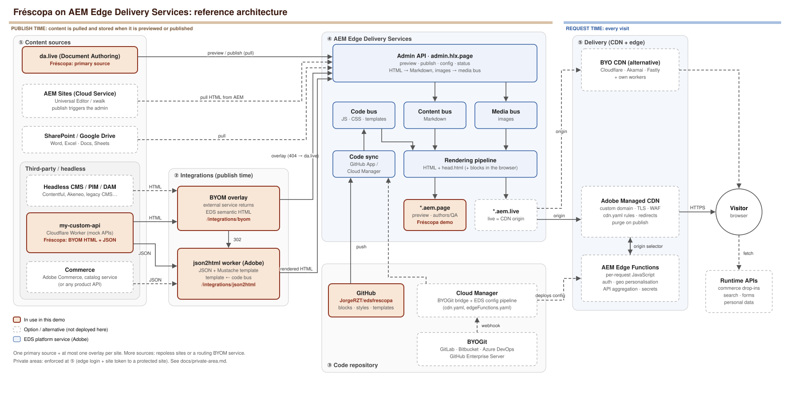

# Fréscopa on AEM Edge Delivery Services + Document Authoring

[](https://www.aem.live/)
[](https://da.live/#/jorgerzt/edsfrescopa)
[](https://main--edsfrescopa--jorgerzt.aem.page/)
[](https://main--edsfrescopa--jorgerzt.aem.live/)
[](https://github.com/apps/aem-code-sync)
[](https://github.com/aemsites/da-block-collection)

[](https://github.com/JorgeRZT/edsfrescopa/actions/workflows/main.yaml)
[](https://github.com/JorgeRZT/edsfrescopa/actions/workflows/redirects-sync.yaml)
[](LICENSE)
[](https://github.com/JorgeRZT/edsfrescopa/commits/main)
[](package.json)
[](scripts/scripts.js)


A migration of [frescopa.coffee](https://frescopa.coffee/) to an AEM Edge Delivery Services project with content in Document Authoring (da.live). It is built on the [`aemsites/da-block-collection`](https://github.com/aemsites/da-block-collection) template. The visual blocks, styles, fonts and icons are ported from the source project [`aem-showcase/frescopa`](https://github.com/aem-showcase/frescopa) (Apache-2.0).

- **Content (DA):** https://da.live/#/jorgerzt/edsfrescopa. Pages are in the root (EN), `/en/`, `/es/`, `/fr/` and `/jp/`. Images are in `/media/`, header and footer in `nav` and `footer` (plus `/<locale>/nav|footer`), and the enquiry form in `/forms/enquire`.
- **Preview:** https://main--edsfrescopa--jorgerzt.aem.page/
- **Live:** https://main--edsfrescopa--jorgerzt.aem.live/. All content pages are published, because the query index (search and sitemaps) only contains published pages. Crawlers are still kept out: EDS always serves `Disallow: /` as `robots.txt` on `*.aem.page` and `*.aem.live`.

## Differences from the source site

The source is an xwalk site (Universal Editor + AEM Author) with Adobe Commerce drop-ins. In this project:

| Area | Source | Here |
| --- | --- | --- |
| `offer`, `article`, `quiz` | AEM Content Fragments via GraphQL persisted queries | Fragment data captured at migration time and authored as rows in the block table (see each block's JS header comment). The quiz is plain JS with no React. |
| `product-list-page-custom` (coffee, tea, machines, accessories, `/products`) | Adobe Commerce catalog service | Static rows (`image \| name \| description \| price`) captured from the rendered source. Client-side sorting and the product count still work. The links to product detail pages are removed. |
| `store-locator` | Google Maps + location API | Static panel (title, CTA, post-code field) with an illustrated map background. |
| Header | Commerce mini-cart, auth, CUG, search autocomplete | Same look. The cart, account and sign-in are visual only. Search posts to `/search`. An EN/ES/FR/JP language switcher was added. Each locale loads its own `/<locale>/nav`. |
| Forms (`form`, `embed-adaptive-form`) | AEM Forms | Form definitions are kept in the DA documents. They render fully, but there is no submission or prefill backend. |
| `dm-video`, `dm-scene7-template`, `video`, Dynamic Media images | Dynamic Media | Unchanged; they still load from the source DM delivery hosts. The DM player on `/sustainability` fails on the source as well. |
| Experimentation, UE instrumentation, importmap, commerce drop-ins | yes | removed |

The source references a few DAM assets that return 404 (for example `AdobeStock_278243111.jpeg` and the `/rise-and-shine` mp4). Those were dropped.

## Desarrollos en el portal

Every capability, integration and use case in this project, and its status:

- ✅ **Implemented:** working on preview (https://main--edsfrescopa--jorgerzt.aem.page) and live (https://main--edsfrescopa--jorgerzt.aem.live).
- 🟡 **Partial:** works, with a known gap.
- 📄 **Documented only:** explained in `docs/`, **not implemented**, because it needs something a demo site does not have (a connected production domain, an identity provider).

Nothing here depends on Universal Editor or AEM Author: these are EDS capabilities, used from Experience Workspace (da.live).

### Implemented and partial

| Status | Capability | Use case it shows | Try it | Where it lives |
| --- | --- | --- | --- | --- |
| ✅ | **Migration of frescopa.coffee to EDS** | Move an AEM (xwalk) + Commerce site to EDS with content in documents | [Home](https://main--edsfrescopa--jorgerzt.aem.page/) | Whole repo; [differences from the source](#differences-from-the-source-site) |
| ✅ | **Authoring in Experience Workspace (da.live)** | Business users edit pages and sheets as documents; preview and publish without developers | [da.live](https://da.live/#/jorgerzt/edsfrescopa) | da.live; sidekick in [`tools/sidekick`](tools/sidekick/config.json) |
| ✅ | **Block library** (teaser, hero, cards, carousel, tabs, accordion, columns, table, quote, sticky-cta, reward, embed) | Reusable components: a table in the document → decorated HTML + CSS + JS | [/subscription](https://main--edsfrescopa--jorgerzt.aem.page/subscription) | [`blocks/`](blocks) |
| ✅ | **Fragments and modals** (fragment, modal, header, footer) | Reuse content across pages; header and footer are documents too | Header and footer on every page | [`blocks/fragment`](blocks/fragment), [`blocks/modal`](blocks/modal) |
| ✅ | **Content Fragment data as authored content** (offer, article, quiz) | Replace runtime GraphQL calls with rows authors edit | [/quiz](https://main--edsfrescopa--jorgerzt.aem.page/quiz), [/rise-and-shine](https://main--edsfrescopa--jorgerzt.aem.page/rise-and-shine) | [`blocks/quiz`](blocks/quiz), [`blocks/offer`](blocks/offer), [`blocks/article`](blocks/article) |
| ✅ | **Product listing** with client-side sorting and count | Catalogue page without a commerce backend | [/coffee](https://main--edsfrescopa--jorgerzt.aem.page/coffee), [/machines](https://main--edsfrescopa--jorgerzt.aem.page/machines) | [`blocks/product-list-page-custom`](blocks/product-list-page-custom) |
| ✅ | **Store locator** | Static locator panel | [/locations](https://main--edsfrescopa--jorgerzt.aem.page/locations) | [`blocks/store-locator`](blocks/store-locator) |
| ✅ | **Dynamic Media** (dm-video, dm-scene7-template, video) | Images and video delivered from AEM Assets / Dynamic Media inside EDS | [/sustainability](https://main--edsfrescopa--jorgerzt.aem.page/sustainability) | [`blocks/dm-video`](blocks/dm-video), [`blocks/dm-scene7-template`](blocks/dm-scene7-template) |
| ✅ | **Multi-language site** (`/en`, `/es`, `/fr`, `/jp`) with switcher and nav per locale | Localised sites from one codebase | [/es/](https://main--edsfrescopa--jorgerzt.aem.page/es/), [/jp/](https://main--edsfrescopa--jorgerzt.aem.page/jp/) | da.live folders; [`blocks/header`](blocks/header), `LOCALES` in [`scripts/scripts.js`](scripts/scripts.js) |
| ✅ | **BYOM** | A page served by an external system (commerce, PIM, headless CMS) as EDS HTML | [/integrations/byom](https://main--edsfrescopa--jorgerzt.aem.page/integrations/byom) | Site overlay + my-custom-api · [docs/byom.md](docs/byom.md) |
| ✅ | **json2html** | External JSON + a Mustache template in the repo = EDS page | [/integrations/json2html](https://main--edsfrescopa--jorgerzt.aem.page/integrations/json2html) | [`templates/json2html`](templates/json2html) · [docs/json2html.md](docs/json2html.md) |
| ✅ | **Redirects authored in EW** | Authors manage 301s in a sheet; migrations with URL maps | [/cafe](https://main--edsfrescopa--jorgerzt.aem.page/cafe) → /coffee | `redirects` sheet in da.live · [docs/redirects.md](docs/redirects.md) |
| ✅ | **Redirects defined by an API** | An external system owns some redirects; a GitHub Action syncs them into the same sheet | [/products/cold-brew-kit](https://main--edsfrescopa--jorgerzt.aem.page/products/cold-brew-kit) → /coffee | [`tools/redirects-sync`](tools/redirects-sync), [workflow](.github/workflows/redirects-sync.yaml) · [docs/redirects.md](docs/redirects.md#redirects-defined-by-an-api) |
| ✅ | **Security baseline** | CSP with nonces moved to an HTTP header; `noindex` per page through metadata, never global | View source on any page | [`head.html`](head.html) |
| ✅ | **Site search per language** | Search box in the header and a results page per locale, over a query index generated on publish; no search backend | [/search?q=coffee](https://main--edsfrescopa--jorgerzt.aem.live/search?q=coffee), [/es/search?q=café](https://main--edsfrescopa--jorgerzt.aem.live/es/search?q=caf%C3%A9) | [`blocks/search`](blocks/search), [`query.yaml`](tools/search-config/query.yaml) · [docs/search-and-sitemaps.md](docs/search-and-sitemaps.md) |
| ✅ | **Sitemaps with hreflang + robots.txt** | SEO: one sitemap per language, alternates between translations, sitemap index referenced from robots | [/sitemap-es.xml](https://main--edsfrescopa--jorgerzt.aem.live/sitemap-es.xml), [/sitemap-index.xml](https://main--edsfrescopa--jorgerzt.aem.live/sitemap-index.xml) | [`sitemap.yaml`](tools/search-config/sitemap.yaml), [`robots.txt`](tools/search-config/robots.txt), [`sitemap-index.xml`](sitemap-index.xml) · [docs/search-and-sitemaps.md](docs/search-and-sitemaps.md) |
| ✅ | **Performance by design** (eager / lazy / delayed loading) | Lighthouse 100 pattern: first section first, the rest later, third parties after 3 s | Any page | [`scripts/scripts.js`](scripts/scripts.js), [`scripts/delayed.js`](scripts/delayed.js) |
| ✅ | **CI** | Lint on every push; event-driven or manual content jobs (redirects sync) | [Actions](https://github.com/JorgeRZT/edsfrescopa/actions) | [`.github/workflows`](.github/workflows) |
| 🟡 | **Forms** (form, embed-adaptive-form) | Forms defined in documents | [/contact-us](https://main--edsfrescopa--jorgerzt.aem.page/contact-us) | Renders fully; **no submission backend** |
| 🟡 | **Translations** | Language copies exist; **translation projects in the EW app are not set up** | [/fr/](https://main--edsfrescopa--jorgerzt.aem.page/fr/) | da.live |

### Documented only (not implemented)

| Status | Capability | Use case | Why it is not implemented | Docs |
| --- | --- | --- | --- | --- |
| 📄 | **Private area** | Members-only section, intranet, B2B portal | Needs an identity provider, a protected site and site tokens on a published site | [docs/private-area.md](docs/private-area.md) |
| 📄 | **Adobe Edge Functions** | Per-request logic at the CDN: headers, A/B, auth at the edge, real-time redirects | Needs a domain connected to the Adobe-managed CDN | [docs/edge-workers.md](docs/edge-workers.md) |
| 📄 | **Adobe-managed CDN** (custom domain, `cdn.yaml`, purge) | Production go-live | Needs a production domain; the demo stays on `aem.page` | [docs/architecture.md](docs/architecture.md), [docs/edge-workers.md](docs/edge-workers.md) |
| 📄 | **Redirects at request time** (wildcards, 302/307/308) | Pattern rules the sheet cannot express | Needs the CDN or Edge Functions (see above) | [docs/redirects.md](docs/redirects.md#other-ways-to-do-it-and-when) |
| 📄 | **BYO Git** (GitLab, Bitbucket, Azure DevOps, GHE) | Customers that cannot use github.com | Needs Cloud Manager; this repo is on github.com | [docs/architecture.md](docs/architecture.md) |
| 📄 | **Other content sources** (AEM Sites, commerce, headless CMS) | Mixing content sources behind one site | Shown with BYOM; no real third-party CMS connected | [docs/architecture.md](docs/architecture.md) |
| — | **Blog** (listing with query index) | Editorial section | Not started; the query index it needs is in place (`template` column) | [docs/search-and-sitemaps.md](docs/search-and-sitemaps.md) |

The external service behind BYOM, json2html and the API redirects is [my-custom-api](https://my-custom-api.lopezpellicerjorge.workers.dev/llms.txt), a Cloudflare Worker that stands in for a commerce, PIM or headless CMS.



## How the integrations work

### 1. BYOM

- **What:** [/integrations/byom](https://main--edsfrescopa--jorgerzt.aem.page/integrations/byom) is not authored in DA. An external service returns finished EDS HTML (sections and block tables) and EDS treats it like any other document.
- **How:** the site's content **overlay** (site config in the Admin API) points at `https://my-custom-api.lopezpellicerjorge.workers.dev/api/frescopa/byom`. EDS asks the overlay first; a 404 falls back to da.live, so only the paths the service knows are taken over.
- **Where it lives:** site config (overlay), endpoint `frescopa/byom` in my-custom-api. No code in this repo: the page uses the existing blocks.
- **When it updates:** when the page is previewed or published.

### 2. json2html

- **What:** [/integrations/json2html](https://main--edsfrescopa--jorgerzt.aem.page/integrations/json2html) is built from raw JSON (`frescopa/roasts`) and a template.
- **How:** the overlay answers that path with a 302 to Adobe's json2html worker, which fetches the JSON and renders it with [`templates/json2html/todays-roasts.html`](templates/json2html/todays-roasts.html) (Mustache). The output is EDS HTML, decorated by the normal blocks.
- **Where it lives:** template in this repo, json2html config for `jorgerzt/edsfrescopa`, JSON endpoint in my-custom-api.
- **When it updates:** when the page is previewed or published.

### 3. Redirects authored in Experience Workspace

- **What:** 301 redirects such as [/cafe](https://main--edsfrescopa--jorgerzt.aem.page/cafe) → /coffee, [/maquinas](https://main--edsfrescopa--jorgerzt.aem.page/maquinas) → /machines and [/tiendas](https://main--edsfrescopa--jorgerzt.aem.page/tiendas) → /locations.
- **How:** a `redirects` sheet in the root of the content with `Source` and `Destination` columns. Authors edit it in Experience Workspace and preview or publish it like any page. No code.
- **Where it lives:** [`redirects`](https://da.live/sheet#/jorgerzt/edsfrescopa/redirects) in da.live, rows with `Origin = EW`.

### 4. Redirects defined by an external API

- **What:** the (fictional) Fréscopa commerce decides redirects when it retires products, closes stores or ends campaigns, for example [/products/cold-brew-kit](https://main--edsfrescopa--jorgerzt.aem.page/products/cold-brew-kit) → /coffee and [/stores/madrid-gran-via](https://main--edsfrescopa--jorgerzt.aem.page/stores/madrid-gran-via) → /locations.
- **How:** EDS only applies the `redirects` sheet, so the API is synced into it. [`tools/redirects-sync/sync-redirects.mjs`](tools/redirects-sync/sync-redirects.mjs) reads [the API](https://my-custom-api.lopezpellicerjorge.workers.dev/api/frescopa/redirects), keeps the authored rows, regenerates the rows with `Origin = API`, writes the sheet to da.live and previews it (or publishes it with `--publish`). Authored rows win on conflict.
- **Trigger:** the GitHub Action [`.github/workflows/redirects-sync.yaml`](.github/workflows/redirects-sync.yaml), started by the external system (`repository_dispatch`, event `redirects-updated`), by hand or by a cron. It needs the `DA_TOKEN` secret; without it, it only runs a dry run.
- **Where it lives:** script and workflow in this repo, endpoint `frescopa/redirects` in my-custom-api, rows with `Origin = API` in the same sheet.

### 5. Search and sitemaps

- **What:** a search box in the header and a results page per language ([/search?q=coffee](https://main--edsfrescopa--jorgerzt.aem.live/search?q=coffee), [/es/search](https://main--edsfrescopa--jorgerzt.aem.live/es/search?q=caf%C3%A9)), and one sitemap per language with hreflang alternates ([/sitemap-en.xml](https://main--edsfrescopa--jorgerzt.aem.live/sitemap-en.xml)).
- **How:** publishing a page indexes it. [`query.yaml`](tools/search-config/query.yaml) defines four indexes (`/query-index.json`, `/es/…`, `/fr/…`, `/jp/…`) with title, description, image, template, robots and lastModified, read from the page `<head>`. The [search block](blocks/search/search.js) fetches the index of the current locale and filters it in the browser, hiding `noindex` pages. [`sitemap.yaml`](tools/search-config/sitemap.yaml) turns the four indexes into `/sitemap-xx.xml` with `hreflang` links between `/coffee`, `/es/coffee`, `/fr/coffee` and `/jp/coffee`.
- **Where it lives:** block and config files in this repo, pushed to the configuration service with [`tools/search-config/apply-config.mjs`](tools/search-config/apply-config.mjs); `search` pages in da.live with `Robots: noindex` metadata.
- **When it updates:** on publish or unpublish. Preview-only pages are not indexed.
- **Details:** [docs/search-and-sitemaps.md](docs/search-and-sitemaps.md).

## Use this repo as a template (code + demo content)

A GitHub template copies only the code: in EDS the code lives in GitHub and the content in da.live. To get the Fréscopa content as well, this repo ships a snapshot of the da.live site in [`demo-content/`](demo-content) (75 pages, 73 images, the `redirects` sheet and the da.live Library in `docs/library`). It is excluded from the code bus by [`.hlxignore`](.hlxignore). [`tools/seed-content/seed.mjs`](tools/seed-content/seed.mjs) uploads it to your site with the DA Source API, the same way `da.live/start` copies its demo content.

1. Click **Use this template** and create the repo in your GitHub org.
2. Install the [AEM Code Sync](https://github.com/apps/aem-code-sync) GitHub app on the new repo.
3. Open [da.live/start](https://da.live/start), paste the repo URL and choose **no demo content**.
4. Sign in to Adobe IMS (`npx -y github:adobe-rnd/da-auth-helper token`, stored in `~/.aem/da-token.json`) or export `DA_TOKEN`. Then seed the content and run a bulk preview:

   ```sh
   ORG=<github-org> SITE=<repo-name> npm run seed:content
   ```

   The script stops if the site is not empty; `--force` overwrites matching paths, `--no-preview` skips the preview and `--dry-run` only lists the files. Links to `content.da.live/jorgerzt/edsfrescopa/…` and `main--edsfrescopa--jorgerzt` are rewritten to your org and site. The script also adds the `library` sheet to the da.live site configuration, so **Library → Blocks, Templates and Icons** appears in the editor (an existing `library` sheet is kept unless you pass `--force`). The library docs under `/docs/` are not previewed.
5. Install the integrations (search and sitemaps, json2html, BYOM overlay) with the setup script. Always use this script rather than configuring them by hand: the configuration lives in the configuration service and the json2html worker, not in the repo, so the template cannot carry it. [`tools/setup-integrations/setup.mjs`](tools/setup-integrations/setup.mjs) applies it to your site with the same IMS token (your user must be an admin of the site) and previews `/integrations/byom` and `/integrations/json2html`:

   ```sh
   ORG=<github-org> SITE=<repo-name> npm run setup:integrations
   ```

   - **search**: pushes [`tools/search-config`](tools/search-config) with the sitemap and robots host rewritten to `main--<repo>--<org>.aem.live`. Publish the site to generate `/query-index.json` and the sitemaps.
   - **json2html**: registers `/integrations/json2html` in the json2html worker for your site, with the template from your own repo and the shared demo JSON.
   - **overlay**: `--overlay=byom` (default) is the Fréscopa setup: the shared demo API serves `/integrations/byom` and redirects `/integrations/json2html` to the json2html worker of the Fréscopa site, so that page uses the Fréscopa template. `--overlay=json2html` makes your site's json2html worker the overlay instead (standard json2html setup: the page uses your template, and `/integrations/byom` no longer exists). `--overlay=none` leaves the overlay untouched.
   - `--only=search,json2html,overlay` runs a subset, `--no-preview` skips the preview and `--dry-run` only prints the calls.

   The BYOM page and the json2html data come from a shared, read-only demo API (`my-custom-api`); to change them, point the overlay and the json2html `endpoint` at your own service.

6. Publish from da.live or the Sidekick when you need the `aem.live` URLs, the query index or the sitemaps.

**Not included** (outside the site config): the external redirects API used by [`tools/redirects-sync`](tools/redirects-sync) (set `REDIRECTS_API`, see [docs/redirects.md](docs/redirects.md)), and anything on the Adobe Managed CDN (edge functions, private area), which needs Cloud Manager.

To refresh the snapshot after editing the source site, run `npm run export:content` and commit `demo-content/`.

## Development

```sh
npm ci
npm run lint
aem up   # local dev with @adobe/aem-cli
```
