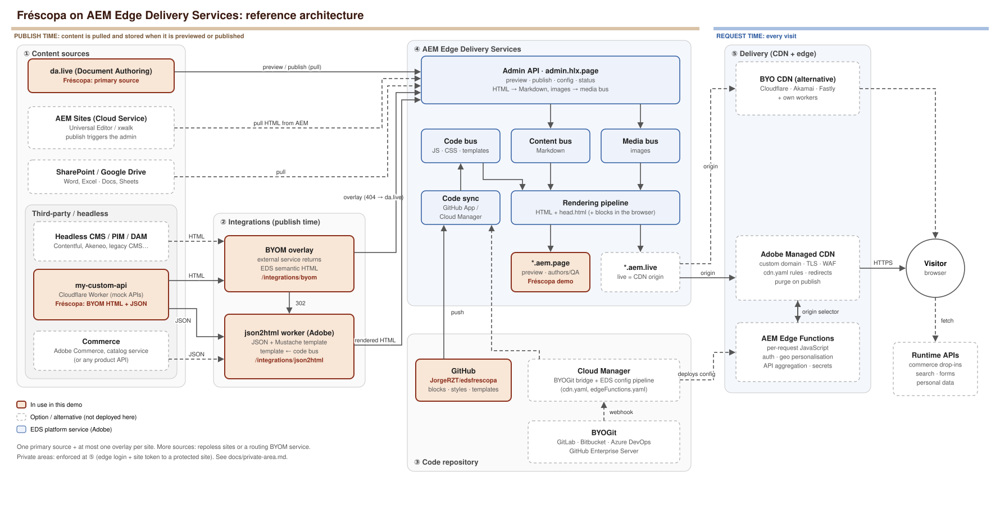

# Architecture

How the pieces of an Edge Delivery Services (EDS) project fit together. The labels show where Fréscopa sits today; the other boxes show the options a real project can choose from.

Official reference: https://www.aem.live/docs/architecture

PNG version (for slides): [architecture.png](architecture.png). The SVG is plain text and can be edited directly.

**Legend:**
- Highlighted boxes are in use in this demo.
- Dashed boxes are options or alternatives that are not deployed here.
- Blue boxes are EDS platform services.

## Reading the diagram

### ① Content sources

Content reaches EDS only through the **Admin API**, either when an author previews or publishes, or through an API call.

| Source | How it reaches EDS | Fréscopa |
| --- | --- | --- |
| **da.live** | The admin *pulls* the document from `content.da.live` | Primary source for all migrated pages |
| **AEM Sites (Universal Editor)** | Publishing in AEM triggers the admin, which pulls semantic HTML from AEM ([docs](https://www.aem.live/docs/aem-authoring)) | The source site `frescopa.coffee` works this way |
| **SharePoint / Google Drive** | The admin pulls Word/Excel or Docs/Sheets ([docs](https://www.aem.live/docs/setup-customer-sharepoint)) | — |
| **Third-party (commerce, headless CMS, PIM, any API)** | Via BYOM or json2html (②), or at runtime from the browser or the edge | my-custom-api |

There is one primary source per site and at most one overlay. To combine more sources, use several repoless sites, or a BYOM service that routes internally (here, a 302 to json2html).

### ② Integrations: BYOM and json2html

- **BYOM:** an external service returns finished EDS HTML for a path. See [byom.md](byom.md).
- **json2html:** Adobe's worker combines JSON with a Mustache template from the code bus. See [json2html.md](json2html.md).

Both run at **preview/publish time**. The result is stored and cached like any other page, so it stays fast and there is no runtime dependency on the third party.

### ③ Code repository and BYOGit

- **GitHub** (this repo) is the standard option. The **AEM Code Sync** GitHub App copies each push into the code bus. There is no build step: the files in the repo are the files served.
- **BYOGit** ([docs](https://www.aem.live/developer/byo-git)): for organisations that cannot use github.com. Supported providers are GitHub Enterprise Server, GitLab, Bitbucket Cloud and Azure DevOps.
  1. Register the repo in **Cloud Manager**.
  2. Add the Cloud Manager webhook to it.
  3. Point the site's `code` config at Cloud Manager.

  Pushes then flow through Cloud Manager into the code bus. The aem.live org name must still exist as a github.com org you control.
- **Repoless:** many sites (brands, locales, a private members site) can share one repo ([docs](https://www.aem.live/docs/repoless)).
- Cloud Manager also runs the **EDS config pipeline** that deploys `cdn.yaml` and `edgeFunctions.yaml` to the Adobe CDN.

### ④ Edge Delivery Services

- The admin converts every source into Markdown in the **content bus** and stores images in the **media bus**. Code sits in the **code bus**.
- The rendering pipeline combines them into HTML plus `head.html`, and blocks decorate the page in the browser.
- `*.aem.page` is preview and `*.aem.live` is live. Live is the origin for the production CDN.

### ⑤ Adobe CDN and the edge

- Production traffic reaches a **custom domain** on the **Adobe Managed CDN**. It provides TLS, WAF and traffic rules, redirects, and automatic purge on publish.
- **AEM Edge Functions** add per-request logic at the CDN: authentication, geo personalisation, API aggregation and secrets. See [edge-workers.md](edge-workers.md).
- Private areas are enforced at this layer. See [private-area.md](private-area.md).
- **BYO CDN** is the alternative. The customer runs Cloudflare, Akamai or Fastly in front of `aem.live` ([docs](https://www.aem.live/docs/byo-cdn-setup)) and writes the edge logic in their own workers.
- At runtime the browser may also call APIs directly, for example **commerce drop-ins** for the cart, account and checkout ([docs](https://experienceleague.adobe.com/developer/commerce/storefront/)), search, or forms submission.

## Publish time vs request time

| | Publish time | Request time |
| --- | --- | --- |
| Who | Admin API, BYOM, json2html | CDN, Edge Functions, browser |
| Output | Static, cached HTML | Per visitor or per second |
| Use for | Pages, catalogues, articles | Cart, stock, auth, personalisation |
| Third-party outage | Page stays up (already stored) | Feature degrades |
