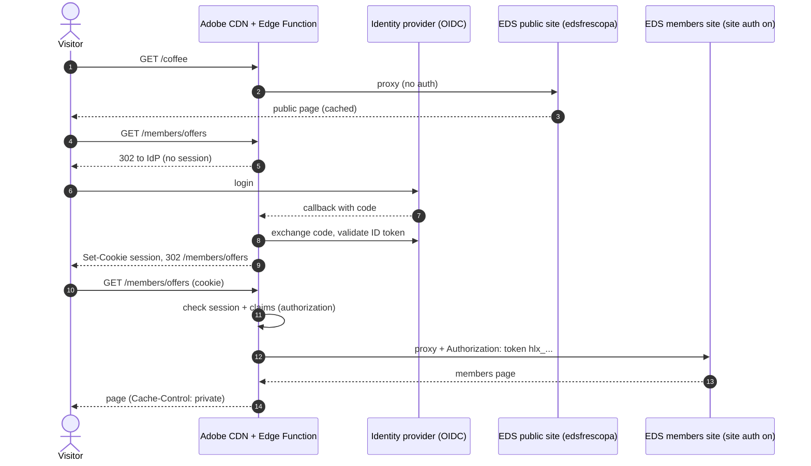

# Private areas in Edge Delivery Services

How to build a members-only area (customer portal, partner area, intranet, gated downloads) on an EDS site such as Fréscopa. **This is documentation only: nothing here is enabled on the demo site.**

Official references:
- Site authentication: https://www.aem.live/docs/authentication-setup-site
- Security overview: https://www.aem.live/docs/security
- Repoless (several sites, one code repo): https://www.aem.live/docs/repoless
- AEM CDN configuration snippets (edge authentication rules): https://experienceleague.adobe.com/en/docs/experience-manager-cloud-service/content/implementing/content-delivery/cdn-configuration-snippets-common-scenarios
- AEM Edge Functions: [edge-workers.md](edge-workers.md)

## The key constraint

EDS is a public, cache-first delivery system. Its built-in **site authentication** works on tokens and has three limits:

- It covers **authentication only**. There is no authorization (no "gold members see X").
- It applies to **the whole site**, or only to preview or only to live. It cannot protect a single path such as `/my-account/*`.
- There is no custom "access denied" page.

So the right design depends on whether the **whole site** is private or only **a section** of a public site.

## Pattern 1: the whole site is private (intranet, partner portal)

Use native site authentication.

1. Create a site token:

   ```sh
   curl -X POST https://admin.hlx.page/config/{org}/sites/{site}/secrets.json -H "Authorization: Bearer $ADMIN_TOKEN"
   # -> { "id": "<secretId>", "value": "hlx_..." }
   ```

2. Require it on preview and live (`access/site.json`), or on preview only (`access/preview.json`):

   ```sh
   curl -X POST https://admin.hlx.page/config/{org}/sites/{site}/access/site.json \
     -H "Authorization: Bearer $ADMIN_TOKEN" -H "content-type: application/json" \
     --data '{ "allow": ["*@frescopa.coffee"], "secretId": ["<secretId>"] }'
   ```

   Each POST replaces the whole object, so GET it first and merge.

3. From then on, `*.aem.page` and `*.aem.live` return **401** unless the request has `Authorization: token hlx_...`.
   - Employees in the `allow` list can browse after signing in with AEM Sidekick.
   - The production CDN must add the token header to every origin request.
   - The real login (SSO with Okta, Entra ID, IMS and so on) happens **at the CDN**, which only forwards to the origin once the user is signed in.

## Pattern 2: a private section inside a public site (recommended for Fréscopa)

Example: `frescopa.coffee/my-account/*` or `/members/*` for logged-in customers.

1. **Two EDS sites, one code base.** Keep the public site (`edsfrescopa`) public. Create a second **repoless** site (e.g. `edsfrescopa-members`) that reuses the same GitHub repo, and therefore the same blocks and styles, with its own content root in DA, e.g. `da.live/#/jorgerzt/edsfrescopa-members`. Turn on **site authentication** (Pattern 1) for that second site only. Its `aem.page`/`aem.live` URLs are now useless without the token.
2. **The CDN handles identity.** On the production domain, the CDN (Adobe Managed CDN, or BYO CDN) routes `/members/*` to logic that:
   1. Checks the user's session cookie. If it is missing, it redirects to the IdP (OIDC: Okta, Entra ID, Auth0, Adobe Commerce customer login, …).
   2. On the IdP callback, validates the ID token and sets a short-lived, `HttpOnly`, `Secure` session cookie.
   3. Proxies the request to `main--edsfrescopa-members--jorgerzt.aem.live`, **adding `Authorization: token <site token>`**. The token is a secret stored at the edge and never sent to the browser.
   4. Optionally checks **authorization** using claims from the token (group, tier, country) before proxying. This is the part EDS does not do itself.
3. **Where that logic runs:**
   - **Adobe Managed CDN:** AEM Edge Functions (see [edge-workers.md](edge-workers.md)). `cdn.yaml` origin selectors route `/members/*` to the function, and the site token is kept as a Cloud Manager secret. Adobe also offers edge authentication rules in `cdn.yaml`; at the time of writing, OIDC login at the edge for EDS is in beta, so confirm availability with the Adobe team.
   - **BYO CDN:** a Cloudflare Worker, Akamai EdgeWorker or Fastly Compute service does the same steps.
4. **Caching:** private HTML must not be cached in shared caches keyed only by URL. Either mark it `Cache-Control: private, no-store`, or vary the cache on the cohort (e.g. tier) rather than the user. User-specific data such as orders and points should be loaded client-side from an authenticated API, so the HTML stays the same for every member.
5. **Hygiene:**
   - Keep private pages out of the public site's sitemap and `query-index`.
   - Add `noindex` to the members site.
   - Never put private content in the public DA tree. Anything previewed on the public site is publicly reachable.



## Pattern 3: public page shell, protected data (client-side)

The page itself is public. A block calls an authenticated API from the browser (e.g. a commerce account drop-in or an orders API with the user's token) and renders the private data.

- This works well for "My account" type pages: the layout is public and the data is personal.
- **It is not access control for content.** Anything in the HTML is public, so only use it when the page contains no private content.

## Which one to choose

| Need | Pattern |
| --- | --- |
| Whole intranet or partner portal | 1: site authentication plus SSO at the CDN |
| Members section in a public brand site | 2: second repoless site with site auth, edge login and proxy |
| Account pages with personal data | 3: public shell plus authenticated APIs (often combined with 2) |
| Hide drafts from the public | Preview-only site auth (`access/preview.json`) |
